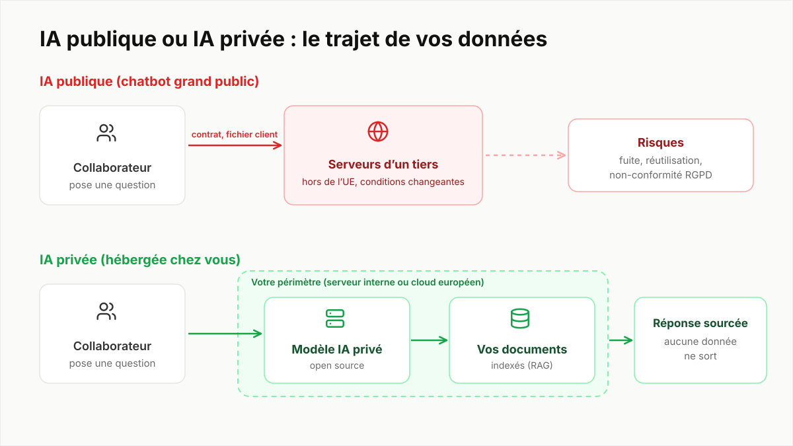

Un collaborateur colle un contrat client dans un chatbot gratuit pour le résumer. Le gain de temps est réel, mais le contrat vient de partir chez un tiers. Pour aider les organisations à éviter ce scénario, la CNIL a publié des questions-réponses sur le déploiement des systèmes d'IA générative [1]. Voici ce qu'il faut en retenir pour une PME.

## 1. Partir d'un besoin concret

La CNIL recommande de « partir de besoins concrets » plutôt que d'un outil [1]. Le niveau de risque dépend de l'usage : un assistant d'aide à la rédaction interne n'a pas les mêmes enjeux qu'un outil qui aide à prendre une décision sur un client ou un candidat.

## 2. Choisir le bon mode de déploiement

C'est le point le plus structurant. Pour des données confidentielles ou sensibles, la CNIL juge « plus opportun et plus sécurisé » de privilégier une solution déployée sur site [1]. L'ANSSI va dans le même sens et recommande de proscrire les outils d'IA générative accessibles sur Internet pour un usage professionnel impliquant des données sensibles [3].

Un service grand public reste envisageable pour des usages non confidentiels, avec des garanties : pas de comptes personnels, et la réutilisation des données par le fournisseur désactivée [1]. En cloud, un contrat de sous-traitance doit préciser qui fait quoi et qui accède aux données ; hors de l'Union européenne, des garanties supplémentaires s'imposent pour les transferts [1].

## 3. Clarifier qui est responsable

L'entreprise doit analyser son rôle et celui du fournisseur au regard du RGPD [1]. Un point souvent ignoré : si vous connectez un modèle à votre propre base documentaire (RAG) contenant des données personnelles, vous devenez responsable de ce traitement [1].

## 4. Encadrer les usages par une charte

La CNIL recommande des politiques ou chartes internes qui listent clairement les usages autorisés et interdits [1]. Une règle de base y figure : ne jamais partager d'informations confidentielles, comme des données personnelles, surtout sur un service public. Quand le fournisseur peut réutiliser les données, c'est à vous de décider si vous interdisez toutes les données personnelles ou seulement certaines catégories [1].

## 5. Former les utilisateurs

Les équipes doivent connaître le fonctionnement et les limites de ces outils. La CNIL invite à vérifier les réponses (exactitude, plagiat, biais) et à ne jamais reprendre une sortie telle quelle [1].

> Une IA générative se trompe avec aplomb. La relecture humaine n'est pas une option.

## 6. Associer le DPO et évaluer les risques

Le délégué à la protection des données peut utilement piloter la démarche, avec le RSSI [1]. Selon les cas, une analyse d'impact relative à la protection des données (AIPD) est à réaliser [1]. Prévoyez aussi un point de contact pour remonter les problèmes et des contrôles réguliers.

## Et pour aller plus loin

La CNIL a finalisé en juillet 2025 ses recommandations sur le développement des systèmes d'IA, avec une liste de points à vérifier, et annonce des travaux sur l'IA au travail [2]. Côté sécurité, le guide de l'ANSSI détaille 35 recommandations, de l'hébergement à la journalisation [3].

## En résumé

Un besoin précis, un déploiement adapté à la sensibilité des données, une charte, une formation et un DPO dans la boucle. C'est la démarche que nous appliquons quand nous installons un assistant IA privé : vos documents restent dans votre périmètre, et la conformité en est d'autant plus simple.

*Cet article résume des recommandations publiques ; il ne remplace pas l'avis de votre DPO ou d'un juriste.*
